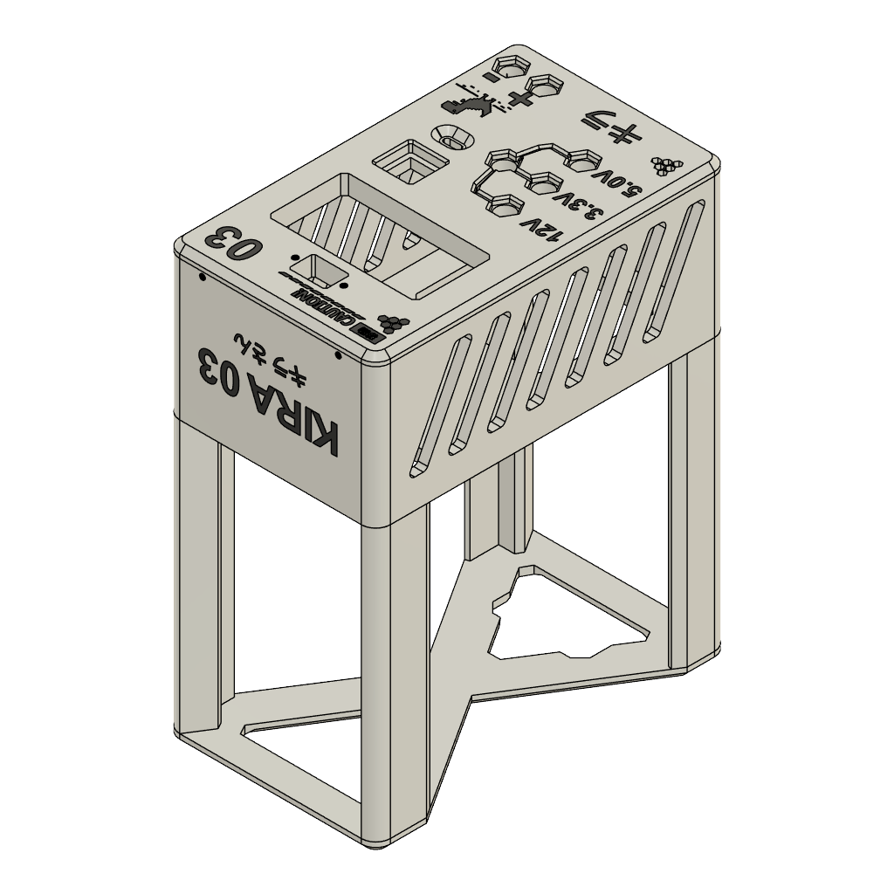

# Enclosure model

[Download/open the supplied 3MF](power%20supply%20v.2.3mf)

The creator identified this file in Downloads as the enclosure source for the project. It was copied here unchanged. The preview above is the archive's own thumbnail, not a newly generated rendering or proof of printability.

## Inspection results

- File: `power supply v.2.3mf` (2,679,250 bytes).
- Declared units: millimeters.
- Embedded title: `power supply v.2 (v1~recovered)`.
- 74 mesh objects and 74 build items, with no non-identity build-item transforms.
- 177,806 triangles in total.
- Main named objects: `Backside`, `Face`, and `Middle`; the remaining objects use Body names.
- Combined mesh extents in file coordinates: approximately **108.53 × 182.00 × 222.50 mm** along X/Y/Z.
- The preview shows KIRA 03 markings and geometry resembling the photographed enclosure.

These are mesh bounds, not independently measured assembled-product dimensions. Object count is not a screw count or a count of separately printed pieces. Some objects may represent lettering or other details; retain their relationships until reviewed in CAD/slicer software.

The archive contains a model, thumbnail, content-type information, and relationships. No slicer print-settings file, G-code, firmware, schematic, or parametric CAD history was found in it. Mesh parsing does not establish manifoldness, clearances, material suitability, or successful slicing.

## Manufacturing guide

1. Open the 3MF in a compatible slicer as a multipart model, preserving its object positions and millimeter units.
2. Compare the preview and named objects with the actual assembly. Identify which bodies form one part, lettering/color regions, and which must be separated for printing.
3. Review scale against actual modules and connectors. Do not auto-scale to fit a printer.
4. Prepare the Face, Middle, and Backside using validated print orientations. Do not print the entire assembled-position model as one object without reviewing its geometry.
5. Assign the creator-confirmed PLA material, then establish printer-specific nozzle, layer height, walls, infill, support, and temperature settings through fit and thermal validation.
6. Print a critical fit sample first where practical. Check display fit, connector holes, fasteners, and panel alignment against actual components.
7. Inspect the finished parts and dry-fit them with power disconnected. Record orientation, support removal, part mass, print duration, and any dimensional compensation used.
8. Publish the validated slicer project alongside this model, including printer, nozzle, material, and profile versions. Publish editable CAD/STEP if available for easier changes to fit another PSU.

The creator confirmed M2 and M3 screws, but counts, lengths, head types, and nut/insert arrangements are not yet provided. Do not infer them from nominal screw diameter alone.

PLA is the creator's material choice, not a verified thermal/fire rating for the electrical assembly. Assess temperatures and enclosure suitability using the final load and airflow arrangement.

## Visual assembly model (SK120, donor PSU, XT60)

[`assembly/benchy_kira03_assembly.glb`](assembly/benchy_kira03_assembly.glb) places the internal hardware inside the enclosure for renders, fit checks and the product video. Regenerate it with `python build_assembly_model.py` (needs `trimesh numpy shapely manifold3d scipy matplotlib`).

The output frame is millimetres, **+Y up, front panel facing +Z**. The source 3MF is stored upside down, so the script rotates it 180° about Z. Each part is a named node (`enclosure/…`, `sk120/…`, `psu/…`, `xt60/…`, `panel/…`, `wiring/…`), so a viewer or animation can show, hide or move groups.

| Part | Source | Placement |
|---|---|---|
| XY-SK120 module | Third-party OBJ in [`third-party/xy-sk120/`](third-party/xy-sk120/) (cm, scaled ×10) | 76.6 × 40 mm display window, centre (0, 34.5). Bezel flange on the panel face (z = 217); body 75.4 × 36.8 mm, 0.6 mm clearance per side |
| Donor PSU | Generic ATX stand-in, 150 × 86 × 140 mm, 3 mm edge radius, 80 mm rear fan, IEC C14 inlet, rocker switch. Also exported as `assembly/psu_reference.stl` | Standing on its side, rear on the back panel (z = 0), front on the internal bulkhead (z = 140). The corner gussets cradle its rounded corners (0.0 mm measured overlap). Cable grommet passes through the 70 × 60 mm bulkhead opening |
| XT60 panel mount (female) | Modelled from XT60E-style panel-mount dimensions: 31 × 12 mm flange, M2.5 holes 25 mm apart, D-shaped housing. Also exported as `assembly/xt60_reference.stl` | 19 × 13 mm window above the display, centre (0, 65.9) |
| Banana jacks, "?" button, indicator lens | Simple stand-ins | Taken from the front-panel cut-outs |
| Wiring | Illustrative only, **not** a wiring diagram | PSU rails → fixed jacks and SK120 input, SK120 output → adjustable jacks and XT60 |

The PSU and XT60 are generic stand-ins based on standard dimensions, not measurements of the creator's donor unit. Replace the PSU with the real model's dimensions (label photo, fan position, inlet side) before using it for fit decisions. Confirm the SK120 model's source and licence before redistributing it.
